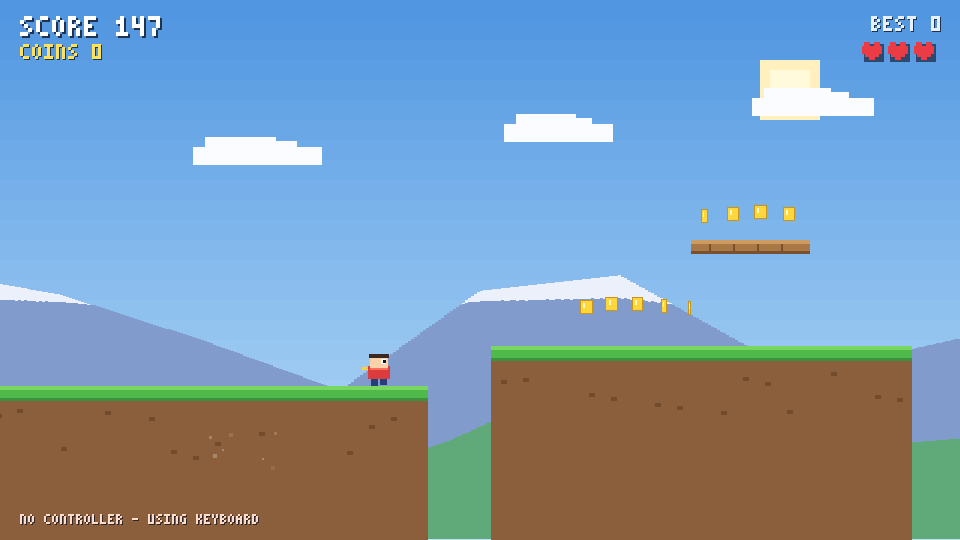

# ds3-jumper

A tiny side-scrolling platformer made to play with a **PS3 DualShock 3** controller.
Written in C99 with SDL2 — runs on **Linux, macOS and other Unix systems**.



Run, jump over gaps, grab coins and stomp enemies in an endless, procedurally
generated world that gets harder the further you go. The controller rumbles when
you get hit, grab coins or stomp enemies, and LED 1 lights up (no more blinking).

## Build & run

Install SDL2 and a C compiler:

```sh
# Debian / Ubuntu
sudo apt install build-essential libsdl2-dev
# Fedora
sudo dnf install gcc make SDL2-devel
# Arch
sudo pacman -S base-devel sdl2
# macOS (Homebrew)
brew install sdl2
```

Then:

```sh
make
./ds3-jumper            # fullscreen
./ds3-jumper --windowed # in a window
```

## Controls

| PS3 controller | Keyboard | Action |
|---|---|---|
| Left stick / D-pad | Arrows / A D | Move |
| ✕ Cross | Space / Up / W / Z | Jump (hold for higher) |
| □ Square / R2 | Shift / X | Run |
| START | Enter / Esc / P | Pause |
| SELECT | R | Restart |
| △ Triangle | F / F11 | Toggle fullscreen |
| PS | Q | Pause / quit (from menus) |

## Controller notes

- **macOS:** plug the DS3 in with a USB cable. macOS has no DS3 driver, but SDL's
  own HIDAPI driver activates it, so no extra tools (`ds3activate`) are needed.
  Wireless DS3 doesn't work on macOS 12+ — see
  [ds3pair-macos](https://github.com/danidomi/ds3pair-macos) for why.
- **Linux:** works over USB out of the box (kernel `hid-sony` driver), and over
  Bluetooth after pairing it once with BlueZ (plug it in via USB, accept the
  pairing prompt in `bluetoothctl`, unplug, press PS). If the controller isn't
  detected, check you have read access to `/dev/input/event*` / `/dev/hidraw*`.
- Other controllers supported by SDL (DualShock 4, DualSense, Xbox, …) work too.

## Development

```sh
make                                # build
./ds3-jumper --screenshot shot.bmp  # headless: simulate 4 s of play, save a frame
make clean
```

Everything is drawn with code (rectangles and a built-in 3×5 pixel font) — no
image or font assets.
