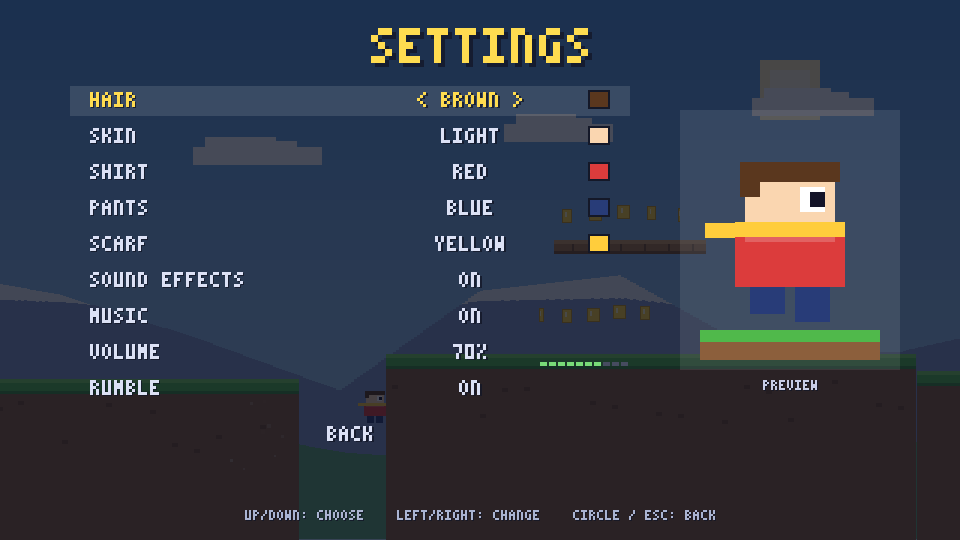

# ds3-jumper

A tiny side-scrolling platformer made to play with a **PS3 DualShock 3** controller.
Written in C99 with SDL2 — runs on **Linux, macOS and other Unix systems**.


Run, jump over gaps, grab coins and stomp enemies in an endless, procedurally
generated world that gets harder the further you go. The controller rumbles when
you get hit, grab coins or stomp enemies, and LED 1 lights up (no more blinking).
Retro sound effects and an original chiptune soundtrack are synthesized in code.

## Build & run

Install SDL2 and a C compiler:

```sh
# Debian / Ubuntu
sudo apt install build-essential libsdl2-dev
# Fedora
sudo dnf install gcc make SDL2-devel
# Arch
sudo pacman -S base-devel sdl2
# macOS (Homebrew)
brew install sdl2
```

Then:

```sh
make start      # build and play (fullscreen)
make windowed   # build and play in a window
make stats      # show your saved stats
```

Or run the binary directly: `./ds3-jumper [--windowed] [--stats]`.

## Saved stats

After every game (game over, restart, or quitting mid-run) your stats are saved
to a plain text file:

| OS | Save file |
|---|---|
| Linux / BSD | `~/.local/share/danidomi/ds3-jumper/save.txt` |
| macOS | `~/Library/Application Support/danidomi/ds3-jumper/save.txt` |

Set `DS3_JUMPER_SAVE=/some/file.txt` to use a different file. It looks like:

```ini
# ds3-jumper save file
best_score = 1520
last_score = 830
games_played = 12
coins_total = 214
best_coins = 41
enemies_stomped = 37
distance_total = 9450
play_seconds = 1260
last_played = 2026-11-24 15:55
```

Your best score and totals are shown on the title screen. Delete the file to reset.

## Controls

| PS3 controller | Keyboard | Action |
|---|---|---|
| Left stick / D-pad | Arrows / A D | Move |
| ✕ Cross | Space / Up / W / Z | Jump (hold for higher) |
| □ Square / R2 | Shift / X | Run |
| START | Enter / Esc / P | Pause |
| SELECT | R | Restart |
| △ Triangle | F / F11 | Toggle fullscreen |
| PS | Q | Pause / quit (from menus) |

In menus: **D-pad / stick** to choose, **✕** (Enter / Space) to confirm,
**○** (Esc / Backspace) to go back.

## Settings

Open **Settings** from the title screen or the pause menu.



- **Character:** hair, skin, shirt, pants and scarf colors, with a live preview
- **Sound effects** on/off, **music** on/off, **volume** 0–100%
- **Rumble** on/off

Settings are saved to `settings.txt` next to the save file (see below), which you
can also edit by hand. Override its location with `DS3_JUMPER_SETTINGS=/some/file.txt`.

## Controller notes

- **macOS:** plug the DS3 in with a USB cable. macOS has no DS3 driver, but SDL's
  own HIDAPI driver activates it, so no extra tools (`ds3activate`) are needed.
  Wireless DS3 doesn't work on macOS 12+ — see
  [ds3pair-macos](https://github.com/danidomi/ds3pair-macos) for why.
- **Linux:** works over USB out of the box (kernel `hid-sony` driver), and over
  Bluetooth after pairing it once with BlueZ (plug it in via USB, accept the
  pairing prompt in `bluetoothctl`, unplug, press PS). If the controller isn't
  detected, check you have read access to `/dev/input/event*` / `/dev/hidraw*`.
- Other controllers supported by SDL (DualShock 4, DualSense, Xbox, …) work too.

## Development

```sh
make                                # build
make start                          # build and play
./ds3-jumper --screenshot shot.bmp  # headless: simulate 4 s of play, save a frame
./ds3-jumper --screenshot s.bmp --screen settings   # title | play | pause | settings | over
make clean
```

Everything is drawn with code (rectangles and a built-in 3×5 pixel font) and all
sound is synthesized (`src/audio.c`) — no image, font or audio assets.
